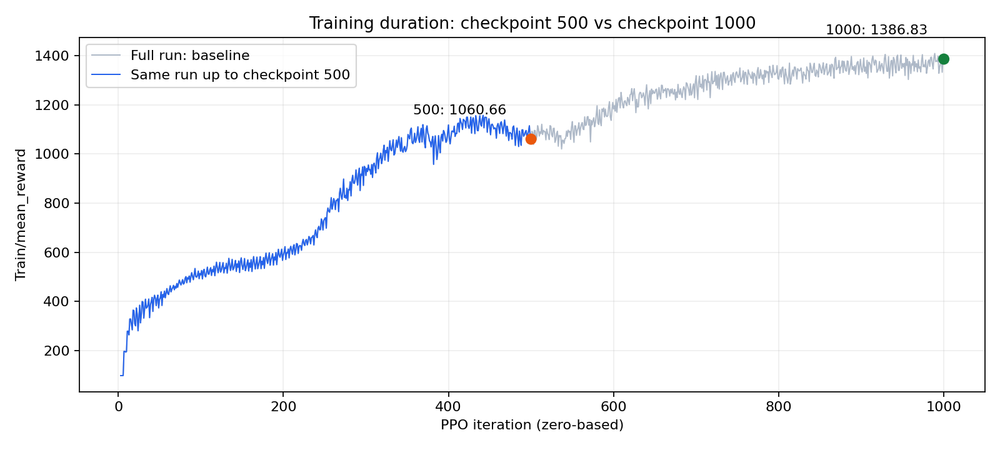

# Урок 4: влияние длительности обучения

## Метод

Сравниваются model_500.pt и model_1000.pt из одного запуска PandaPickCube_20261011_145632. Таким образом, num_envs=4096, seed обучения=1, архитектура, награда и конфигурация одинаковы. Отличается длительность обучения до выбранной точки. Исходный полный запуск имел max_iters=1001.

## Таблица сравнения

| Эксперимент | Изменения в коде / настройки | mean_reward обучения | SR | Время обучения до точки | Поведение |
|---|---|---:|---|---|---|
| baseline: model_1000.pt | Полный исходный запуск: NUM_ENVS=4096, MAX_ITERS=1001, SEED=1 | 1386.83 | 10/10 (100%) | ≈1952 с - 32 мин 32 с | Захватывает куб и доставляет к цели во всех десяти оценённых эпизодах |
| checkpoint_500: model_500.pt | Правок обучения нет; выбран более ранний чекпоинт того же запуска | 1060.66 | 7/10 (70%) | ≈1019 с - 16 мин 59 с | Поднимает куб во всех десяти эпизодах, но в эпизодах 4, 5 и 8 не доводит его достаточно близко к цели |

Видео: [baseline](../videos/baseline.mp4), [checkpoint_500](../videos/max_iters_500.mp4).

## Сравнение и вывод

- Финальный mean_reward в точке 500 ниже на 326.18, то есть на 23.52% относительно итерации 1000.
- SR снизился с 10/10 до 7/10: на 3 успеха из десяти, или 30 процентных пунктов.
- Время обучения до более ранней точки меньше на 933 с (15 мин 33 с), или на 47.80%.
- Захватов у обеих моделей 10/10. Основная наблюдаемая разница - точность доставки: у model_500.pt неудачные эпизоды завершились расстояниями 0.145, 0.066 и 0.124 м при пороге 0.05 м. На просмотренных кадрах четвёртого эпизода рука поднимает куб, но останавливается в стороне от цели.

Обе метрики качества снизились согласованно. Более короткое обучение экономит почти половину времени, но в этом сравнении ухудшает доставку куба к цели. Исходная кривая после итерации 500 ещё продолжает расти; поэтому раннее завершение отсекает полезные обновления политики. Это наблюдение на одной траектории обучения и десяти эпизодах оценки, а не оценка статистической значимости.

## Кривые обучения

Это одна траектория: синим выделен её участок до итерации 500, серым показан полный запуск. В районе 500 есть промежуточное замедление/просадка; затем рост возобновляется, к 1000 кривая близка к плато.

[Видео инференса checkpoint_500](../videos/max_iters_500.mp4).
