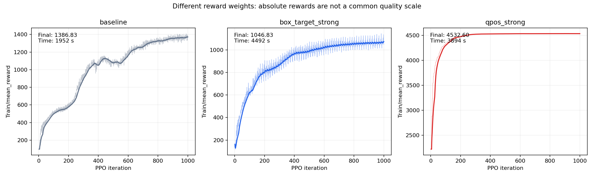

# Урок 5: изменение награды - результаты

## Условия и изменения

- A: `env_cfg.reward_config.scales.box_target = 40.0`; robot_target_qpos оставлен 0.3.
- B: `env_cfg.reward_config.scales.robot_target_qpos = 30.0`; box_target возвращён к 8.0.

## Таблица

| Эксперимент | Изменения в коде / условия | mean_reward обучения | SR | Время обучения | Поведение |
|---|---|---:|---|---|---|
| baseline - model_1000.pt | По исходному ноутбуку NUM_ENVS=4096, MAX_ITERS=1001, SEED=1; изменений награды не зафиксировано | 1386.83 | 10/10 | ≈1952 с - 32 мин 32 с | Захватывает и доставляет куб к цели во всех 10 оценённых эпизодах |
| checkpoint_500 | Более ранний чекпоинт того же запуска | 1060.66 | 7/10 | ≈1019 с - 16 мин 59 с | Поднимает куб в 10/10 эпизодов, в трёх не доводит до цели |
| box_target_strong | `env_cfg.reward_config.scales.box_target = 40.0` | 1046.83 | 0/10 | ≈4492 с - 74 мин 52 с | Подходит к кубу и остаётся возле него на столе; доставок и подъёмов выше 0.2 м нет |
| qpos_strong | `env_cfg.reward_config.scales.robot_target_qpos = 30.0` | 4532.60 | 0/10 | ≈3894 с - 64 мин 54 с | Почти остаётся в стартовой позе, не подходит к кубу; доставок и подъёмов выше 0.2 м нет |

## Опыт A: box_target_strong

Финальный mean_reward = 1046.83, SR = 0/10, подъёмов выше 0.2 м = 0/10. 

На просмотренных кадрах рука быстро подходит к кубу, затем остаётся возле него на уровне стола. В десяти эпизодах куб не доставлен к цели; итоговые расстояния - от 0.228 до 0.436 м. Подъёмов выше принятого порога 0.2 м не зафиксировано.

Это отличается от типичного ожидания урока. Усиление компоненты доставки не гарантировало, что политика освоит перенос. Наблюдаемое поведение согласуется с застреванием в стратегии подхода/удержания гриппера возле куба.

Абсолютный финальный reward ниже baseline на 340.01 (24.52%).

[Видео опыта A](../videos/box_target_strong.mp4).

## Опыт B: qpos_strong

Финальный mean_reward = 4532.60, SR = 0/10, подъёмов выше 0.2 м = 0/10.

На просмотренных кадрах рука почти сохраняет стартовую позу и не приближается к кубу. Кривая награды быстро поднимается и выходит на устойчивое высокое плато; среднее последних 50 значений - 4532.37, предыдущих 50 - 4532.27.

Награда выше baseline на 3145.77 (+226.83%), но задача доставки не решена ни разу. Это искомое расхождение метрик: большой вес близости к стартовой позе делает такое поведение выгодным, а неизменный SR показывает отсутствие решения PickCube.

[Видео опыта B](../videos/qpos_strong.mp4).

## Графики

## Вывод

Усиление box_target в этом запуске не привело к освоению доставки: модель подошла к кубу, но SR остался 0/10. Усиление robot_target_qpos дало высокий reward за сохранение исходной позы при SR 0/10. Поэтому успешную оптимизацию заданной награды нельзя автоматически считать успешным выполнением задачи; нужна независимая метрика SR и просмотр поведения.
